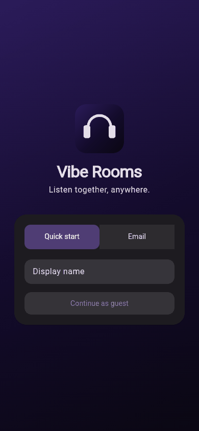
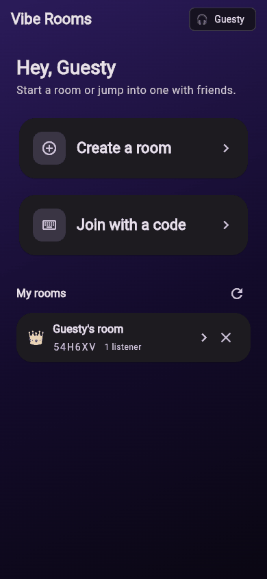
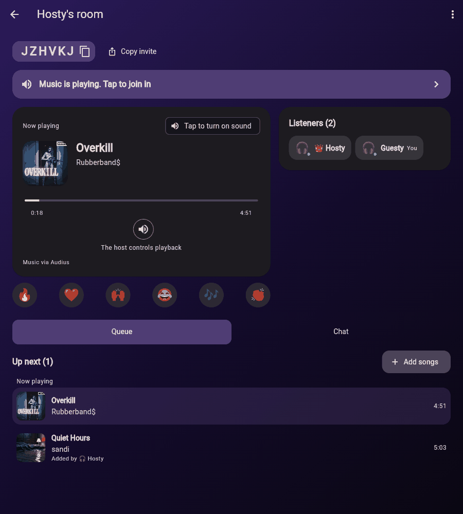
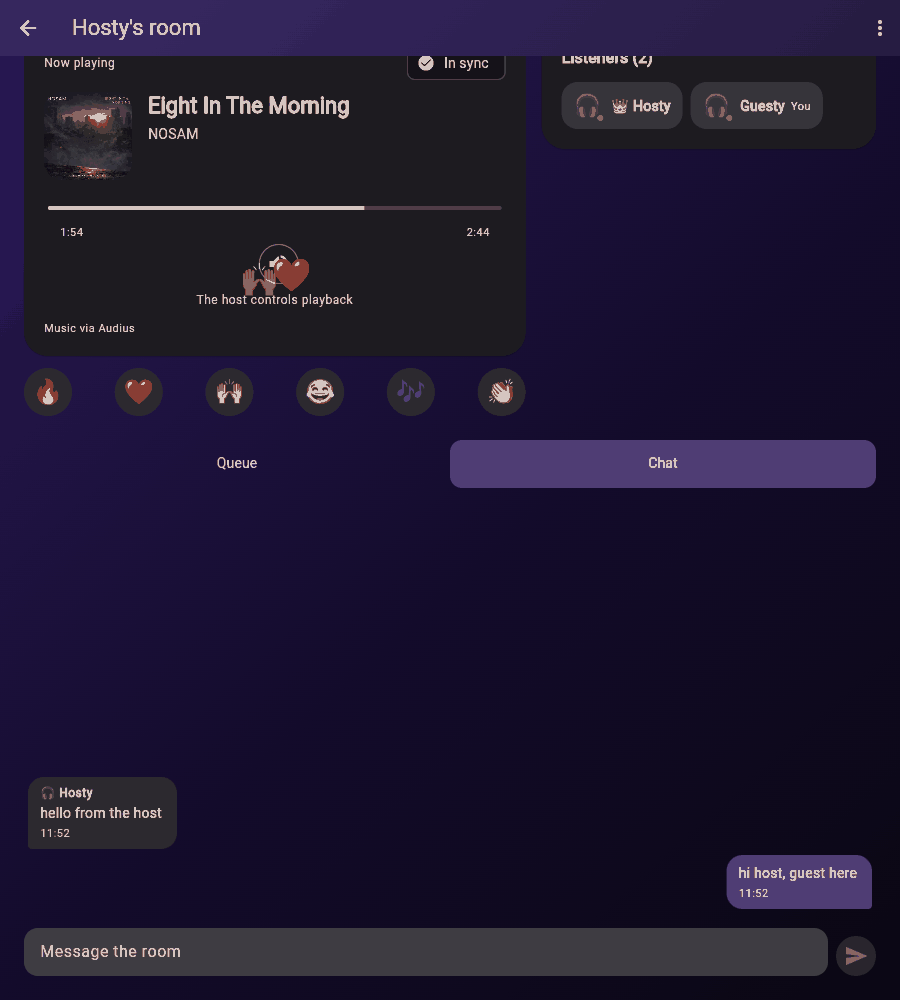
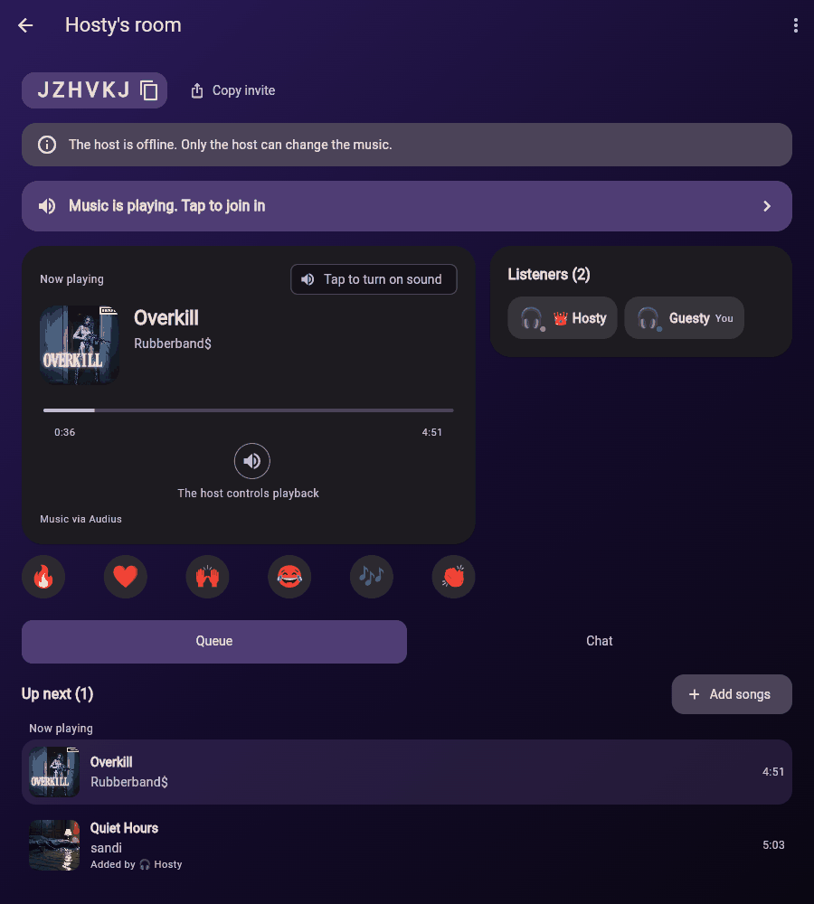
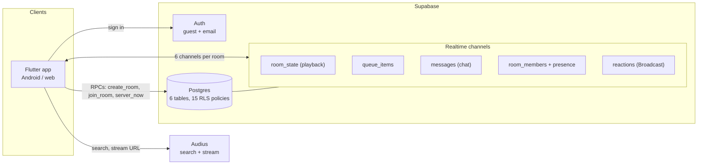

# Vibe Rooms

Friends join a room with a 6-character code and listen to the same [Audius](https://audius.co) track at the same moment, with a shared queue, live chat and emoji reactions. Flutter on the front, Supabase (Auth, Postgres with row level security, Realtime) behind it. Android is the main target; web is used for quick testing and demos.

| Sign in | Home | Room, queue |
|---|---|---|
|  |  |  |

| Chat and reactions | The host is away |
|---|---|
|  |  |

## Features

- **Rooms:** create a room (up to 5 open rooms per host), join with a code or a link, see who is online, close or leave.
- **Synced playback:** the host picks the music and everyone hears the same position. Positions come from the database's clock, not from the phones' clocks.
- **Shared queue:** anyone adds songs (50 per room, 10 per person), the host skips or plays any item, the next song starts by itself.
- **Chat:** live, kept for the room, 500 characters, unread badge, a message you are typing survives switching tabs.
- **Reactions:** six emoji that float up on every screen (a pulse on the button if the device reduces motion).
- **Host-offline notice:** listeners are told, after 10 seconds, when the host has gone.
- **Accessible and responsive:** tested at 320, 390, 768 and 1400 px and at text scale 2.0, with labels on every button.

## Architecture



Every Supabase call goes through a repository in a feature's `data/` folder. State is Riverpod, routing is go_router, audio is just_audio. The code is feature-first (`auth`, `rooms`, `player`, `queue`, `chat`, `reactions`).

**By the numbers:** 6 tables, 15 policies, 7 functions and 2 triggers in the SQL; about 10,700 lines of Dart in 96 files, covered by 657 tests (about 10,600 lines in 37 files) with no network needed; `flutter analyze` reports zero issues.

## Setup

1. Install [Flutter](https://docs.flutter.dev/get-started/install) (stable) and run `flutter doctor`. For Android, install the Android SDK and accept licenses (`flutter doctor --android-licenses`).
2. Create a project at [supabase.com](https://supabase.com). In Project Settings > API, copy the project URL and the anon (publishable) key.
3. Copy the example config and fill in your keys:
   ```
   cp env.example.json env.json
   ```
   `env.json` is git-ignored. Never commit it.
4. `flutter pub get`

Without real keys the app still runs and shows a "Supabase is not configured" banner.

## Run

Android (device or emulator):
```
flutter run --dart-define-from-file=env.json
```

Web:
```
flutter run -d chrome --dart-define-from-file=env.json
```
or, without a local Chrome window: `flutter run -d web-server --web-port 8080 --dart-define-from-file=env.json` and open http://localhost:8080.

## Database setup

Run these steps by hand, once per Supabase project:

1. Open the Supabase SQL editor.
2. Run `supabase/migrations/0001_init.sql`.
3. Run `supabase/tests/verify_structure.sql` and read the table: every table should say "RLS on", the app functions should be "security definer", the four realtime tables should be "in supabase_realtime", and "anon grants" should say "none (good)".
4. Run `supabase/tests/verify_behavior.sql` and expect an error starting with `VERIFY_OK`. That error is intentional: the test rolls itself back. An error starting with `VERIFY_FAIL` names the check that failed.
5. Enable Authentication > Sign In / Providers > Allow anonymous sign-ins.
6. Turn off "Confirm email" for development.
7. Copy the Project URL and the publishable key into `env.json` (never the secret or `service_role` key).

To start over during development, run `supabase/migrations/0000_reset_dev.sql` (it deletes all app data), then run `0001_init.sql` again.

## Sign-in

The app opens on a login screen with two ways in:

- **Quick start:** type a display name and tap "Continue as guest". A guest account lives only in this browser or app; signing out loses it.
- **Email:** sign in, or switch to "Create account" (also asks for a display name). If your Supabase project has "Confirm email" on, creating an account asks you to confirm by email first; for development, turn it off (see Database setup).

Your display name and avatar emoji live in your profile: tap the chip at the top right of the home screen to edit them or sign out. Without a configured `env.json` the login screen explains what is missing and sign-in is disabled.

## Rooms

From the home screen:

- **Create a room:** tap "Create a room", pick a name (up to 40 characters) and tap Create. You land in the room as its host.
- **Join with a code:** tap "Join with a code" and type or paste the 6-character code (spaces and lower case are fine). A wrong or closed code shows "No room with that code."
- **Join with a link (web):** in a room, "Copy invite" copies the code and a link like `http://localhost:8080/#/join/ABC234`. Opening it while signed out takes you to the login screen first and then straight into the room.
- **My rooms** lists your open rooms with a listener count; pull down (or tap the refresh icon) to reload. Inside a room you see who is online in real time. The host can close the room, everyone else can leave it.

## Music

Music search and playback come from [Audius](https://audius.co), the open music platform. In a room, the host taps "Find music" to see trending tracks or search by name, then taps a track to play it for everyone. On the web, tap "Tap to turn on sound" first: browsers block audio until you interact with the page.

Every track shows its artist and "Music via Audius". Tracks are streamed from Audius and never downloaded or stored.

The Audius read API needs no key. If you have a client-side Audius API key you can add it to `env.json` as `"AUDIUS_API_KEY"` (see `env.example.json`; leave it empty otherwise). It is sent only when set. Never put an Audius bearer token there.

## How sync works

In two browser sessions on one machine the measured drift between host and listener had a median of 4 ms and a maximum of 97 ms (round trip to Supabase 237 ms); real phones on mobile data will be worse. The room's playback state is one database row: "at server time T the track was at position P and was playing or paused". Only the host can change it. Every device measures how far its own clock is from the server (five quick `server_now()` calls, keeping the fastest), so it can work out where the music should be right now, and it nudges its player there whenever it drifts by more than about a third of a second. Listeners can only mute locally; the host's play, pause, seek and track changes reach everyone within a second or so. Open "Sync debug" (always on in debug builds, or tap the room name five times) to see the measured clock offset, round trip and drift.

## Queue

Everyone in a room can add songs: open the Queue tab and tap "Add songs", then "+" on any result (the sheet stays open so you can add several). The list is the same for everyone, live, with who added what. The host can play any song right away, skip with "Next", and remove anything; you can remove your own songs. When a song ends, the host's device starts the next one automatically, so keep the host's app open. Limits: 50 songs per room and 10 per person; a song that is already queued can't be added twice.

## Chat and reactions

The Chat tab is a live chat for the room: type a message and press Enter (Shift+Enter for a new line), up to 500 characters. Messages are kept, so you see the latest ones when you come back. The Chat tab shows a small badge for messages you have not read. There is a limit of one message per second, and links in messages are not clickable.

Under the player card are six reaction buttons (🔥 ❤️ 🙌 😂 🎶 👏). Tap one and it floats up on everyone's screen. Reactions are not saved, and if your device is set to reduce motion they pulse on the button instead of floating.

## Develop

```
flutter analyze        # zero issues expected
flutter test           # 657 tests, no network
tool/check_no_secrets.sh
```

`tool/check_no_secrets.sh` fails when a tracked or new file holds a Supabase key prefix, a JWT-looking string or the project URL from `env.json`; run it before every commit (CI will call it later). The app icon is drawn by `python3 tool/generate_icons.py` (Pillow), then `dart run flutter_launcher_icons` and `dart run flutter_native_splash:create` write the Android and web assets.

See [CLAUDE.md](CLAUDE.md) for conventions and the build order.

## Known limitations

This is a demo-grade app. The register in [docs/KNOWN_RISKS.md](docs/KNOWN_RISKS.md) lists 92 items with a severity and a plan; the five that matter most before a public launch are:

- join-by-code has no rate limit (guessing is slow, not impossible);
- chat and queue limits are enforced in the app, not the database;
- presence and reactions use public Realtime channels;
- Android background playback and audio focus are not handled;
- the Audius terms and the Open Music License need a re-read before any commercial use.

The host's device runs the auto-advance, so a host who leaves or backgrounds the app stalls the room (listeners see the host-offline notice).
